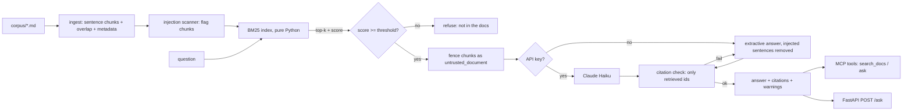

# docs-rag-mcp

**Let your team (and Claude / Cursor) ask questions over your company docs, with citations and prompt-injection defenses.**

## The problem

Policies, onboarding guides and API docs live in a dozen places. People ask the same questions in chat, and
generic chatbots either make answers up or can be steered by a malicious line hidden in a document
("ignore previous instructions..."). You need answers that are **grounded, cited, and safe to feed to an LLM**.

## What this demo does

- Answers questions from `corpus/` (8 sample company docs: HR, refunds, onboarding, API, expenses, incidents, vendors).
- **Every answer cites chunk ids** like `[refund-policy#0]`; the citations are checked before the answer is returned.
- **Refuses** ("I couldn't find that in the docs.") when retrieval confidence is below a threshold.
- **Prompt-injection defense**: `corpus/vendor-faq.md` contains an embedded injection on purpose. It is flagged, fenced, and never obeyed.
- Exposed three ways: Python API, **MCP server** (Claude Desktop, Claude Code, Cursor) and a **FastAPI** `POST /ask`.
- Runs fully **offline** (extractive answers). With `ANTHROPIC_API_KEY` set, answers are written by `claude-haiku-5-5`.

## Architecture



| Module | Role |
|---|---|
| `rag/ingest.py` | Markdown loader, sentence-based chunking with overlap, stable ids `doc#n` |
| `rag/bm25.py` | Okapi BM25, no dependencies. `Retriever` protocol = hook for embeddings / hybrid search |
| `rag/security.py` | Injection scanner, untrusted-data fencing, citation verifier |
| `rag/pipeline.py` | Orchestration: retrieve, threshold, generate, verify, fall back |
| `mcp_server.py` | MCP server (FastMCP, stdio): `search_docs(query, k)`, `ask(question)` |
| `api.py` | `POST /ask` for non-MCP clients |

## Quickstart

```bash
python -m venv .venv && .venv/bin/pip install -r requirements.txt   # Windows: .venv\Scripts\pip
.venv/bin/python -m pytest -q                                        # 15 tests, all offline
```

Ask over HTTP: `uvicorn api:app` then
`curl -X POST localhost:8000/ask -H "content-type: application/json" -d '{"question":"How long do refunds take?"}'`

### Use it from Claude Desktop / Claude Code

Claude Desktop (`claude_desktop_config.json`):

```json
{
  "mcpServers": {
    "company-docs": {
      "command": "/path/to/docs-rag-mcp/.venv/bin/python",
      "args": ["/path/to/docs-rag-mcp/mcp_server.py"],
      "env": { "ANTHROPIC_API_KEY": "optional" }
    }
  }
}
```

Claude Code:

```bash
claude mcp add company-docs -- /path/to/docs-rag-mcp/.venv/bin/python /path/to/docs-rag-mcp/mcp_server.py
```

Cursor uses the same `mcpServers` block in `.cursor/mcp.json`.

## Security

Retrieved documents are **data, not instructions**. Defense in depth:

1. **Scan at ingest**: each chunk is checked for instruction-like content (override phrases, role hijacking,
   exfiltration requests, fake delimiters). Flags travel with the chunk and surface as `warnings`.
2. **Fence at prompt time**: chunks go inside `<untrusted_document id=...>` tags; `<` is escaped so a document
   cannot close the fence. The system prompt tells the model the content is data only.
3. **Strip in the offline path**: flagged sentences are removed before extractive answering.
4. **Verify the output**: the answer must cite at least one source and **only ids that were retrieved**.
   An uncited answer or an invented source is discarded and replaced by the extractive answer.
5. **Refuse below threshold** instead of guessing.
6. MCP `search_docs` returns flags with each chunk so the calling agent knows what is suspicious.

Limits, stated honestly: regex scanning catches common patterns, not every paraphrase. For production I add an
LLM classifier pass, per-source trust levels, and red-team eval cases.

## How I'd do this on YOUR docs

1. **Audit** (week 1): inventory sources (Drive, Confluence, Notion, PDFs), permissions, and the 30 questions people actually ask.
2. **Eval set**: turn those questions into a graded test set (expected doc + answer + must-refuse cases + injection cases), so quality is measured, not guessed.
3. **Build and deploy**: connectors, chunking tuned per document type, hybrid BM25 + embeddings if the eval says it helps,
   access control per user, MCP server for your AI tools plus an HTTP or Slack endpoint, deployed in your cloud.
4. **Monitor**: log questions, refusals and flagged chunks; weekly eval run in CI; alerts when answer quality or coverage drops.

## Offer

| Tier | Scope | Price |
|---|---|---|
| Starter | _placeholder_ | _TBD_ |
| Standard | _placeholder_ | _TBD_ |
| Premium | _placeholder_ | _TBD_ |

All documents in `corpus/` are fictional. No real personal data or secrets.
